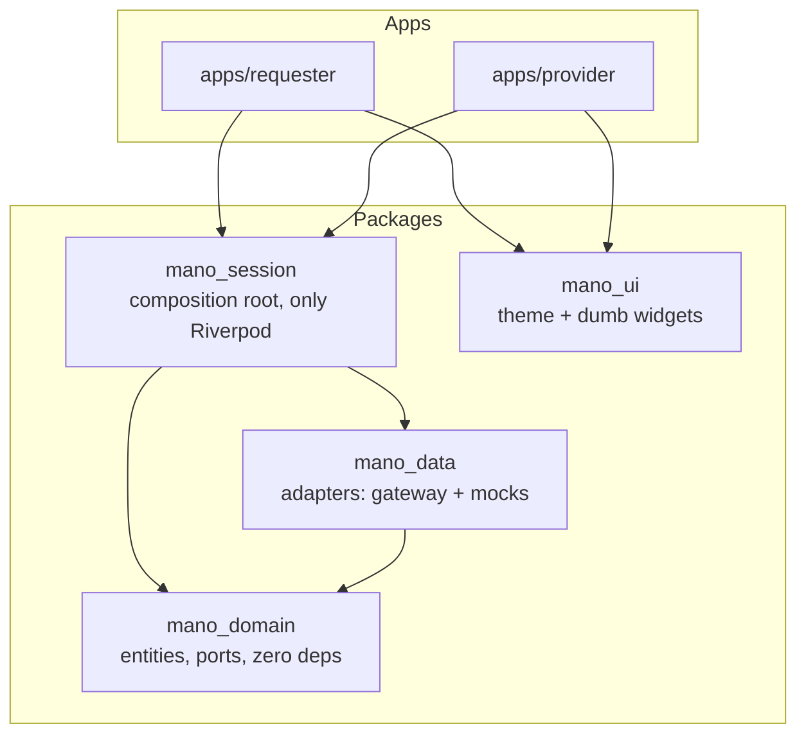

# mano-mobile

The two Mano apps, and the packages they share.

- **`apps/requester`** — Mano, for Solicitantes: people who need work done in
  their home (`com.manoInc.mano` on Android).
- **`apps/provider`** — Mano Profesionales, for Proveedores: people who do the work
  (`com.manoinc.mano.provider`).

Two apps, two store listings, two userbases. One repository, so the design
system and the domain are written once.

## Architecture

The arrows point one way:



Business logic must not depend on the presentation framework. That is enforced
by the build, not by review:

- `mano_domain` declares **no dependencies at all** — not Flutter, not
  Riverpod.
- `mano_ui` declares Flutter and nothing else — never `mano_domain`. A widget
  takes strings, booleans and callbacks; the screen does the mapping.
- Both set `depend_on_referenced_packages: error` in their
  `analysis_options.yaml`, so a boundary-crossing import fails `dart analyze`.
- Apps reach `mano_data` and `mano_domain` only through `mano_session`'s
  re-exports — never directly. The dependency graph above is the real one, not
  a simplification.

Try it:

```dart
// in packages/mano_domain/lib/anything.dart
import 'package:flutter_riverpod/flutter_riverpod.dart';
// error • The imported package 'flutter_riverpod' isn't a dependency
```

Detailed docs live in [`docs/`](docs/). This README is just the map.

## Testing

```bash
cd packages/mano_domain  && dart test        #  67 — no Flutter binding needed
cd packages/mano_data    && flutter test     #  53 — gateway adapters via MockClient, mocks
cd packages/mano_session && flutter test     # 130 — fake repositories, no device
cd packages/mano_ui      && flutter test     # 198 — widgets take strings & callbacks
cd apps/requester        && flutter test     # 119
cd apps/provider         && flutter test     #  87
cd widgetbook            && flutter test     #  71 — every use case renders
cd apps/requester        && flutter test integration_test -d RFGL20WAR9E   # on the phone
```

No host test opens a browser, touches a keystore, or makes a network request.

## Docs

The **Mano Handbook** lives in [`docs/`](docs/): the brand system, components,
product journeys and developer guides. Every widget is also live in the
[`widgetbook/`](widgetbook/) catalogue.

```bash
tools/docs.sh serve   # http://localhost:8000 (Zensical in Docker, catalogue at /widgetbook/)
```

## Quick start

Both apps default to a development gateway reached through `adb reverse`, so
the phone's `localhost` is the host's. The forward does not survive unplugging
or an adb restart; re-run it.

```bash
adb reverse tcp:8082 tcp:8082   # mano-gateway
cd apps/requester && flutter run
```

Sign-in has no backend yet — the screen renders and reports "not configured"
the moment it is pressed. Whatever provider comes next gets its own setup
instructions in this section.

### Environment (`config/*.json`, `.env`)

API URLs and client keys are passed at build time. The shared, public values
are committed: `config/dev.json` for the local stack, `config/prod.json` for
release builds. For personal overrides, copy the app's `.env.example` to a
git-ignored `.env` and pass it after `dev.json`; the later file wins key by key:

```bash
cd apps/requester
flutter run --dart-define-from-file=../../config/dev.json   # shared defaults
cp .env.example .env          # uncomment what you override
flutter run --dart-define-from-file=../../config/dev.json --dart-define-from-file=.env
```

Without `MANO_GATEWAY` the app fails at startup. Values are compiled into the
binary, so only client-side keys belong there, never server secrets.
