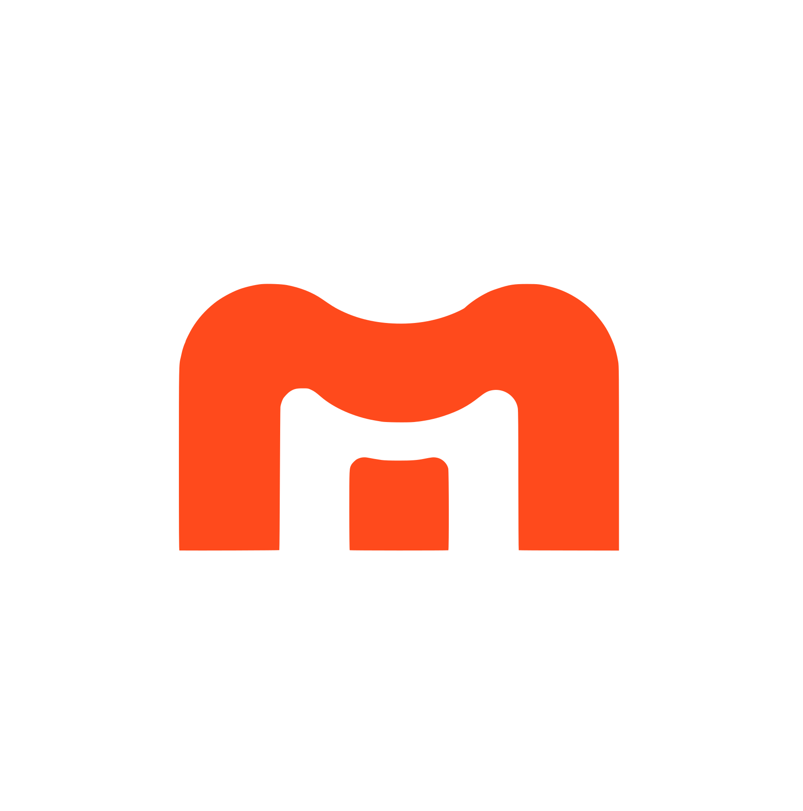

# Logo

The logo is **drawn in Dart**, never shipped as an image. That keeps it sharp at
every size and lets it animate.

{ width="96" }

{ width="220" }

| Widget | What it is | Use |
|---|---|---|
| `ManoWordmark` | "mano" lockup, with a letter-by-letter reveal (`progress`) | Hero screens, the opening |
| `ManoMonogram` | The **m** on its own | App icon, small brand moments |
| `ManoArchMotif` | The arch shape as a background pattern | Behind hero content on flame |
| `ManoOpening` | The cold-start sequence | Wraps each app's root, once per launch |

## Changing the logo

1. Replace the SVG in `tools/brand/`.
2. Run `dart tools/generate_logo_paths.dart`.
3. Commit the regenerated `mano_logo_paths.g.dart`.

## Rules

- **Colour.** The wordmark inherits the text colour: ink on light, white on
  flame. Never place flame on flame.
- **No effects.** Don't stretch, outline, shadow or recolour individual letters.
- **Images.** `mano_ui` ships **no images at all**. Illustrations and
  third-party marks, such as Google's G, are app assets. A shared widget that
  needs one takes it as a `Widget` slot.
