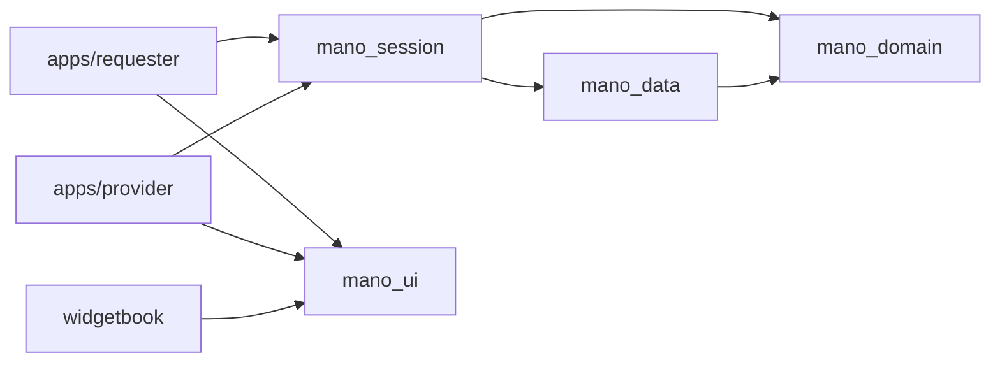
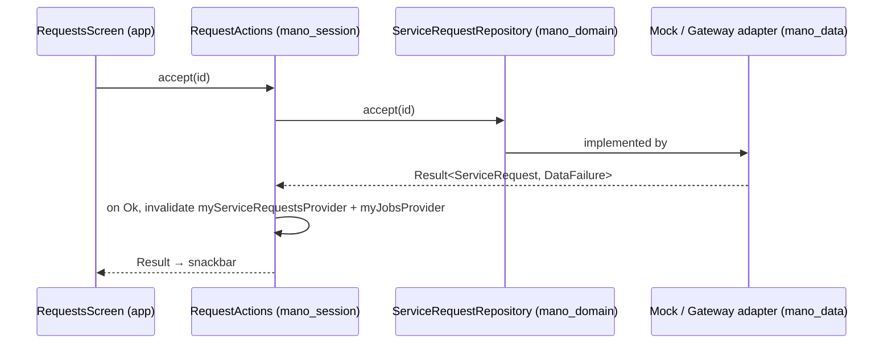

# Architecture

Hexagonal (ports and adapters), split into a Pub workspace so the boundaries are
enforced by the build rather than by review.

| Layer | Package | Holds | May import |
|---|---|---|---|
| Domain | `mano_domain` | entities, enums, pure rules, ports (abstract interfaces), `Result`, failures | nothing |
| Adapters | `mano_data` | gateway adapters (`GatewayTransport`, `Gateway*`) and in-memory `Mock*` adapters | `mano_domain`, `http`, Flutter plugins |
| Composition | `mano_session` | one Riverpod `Provider<Port>` per port, plus feature notifiers | `mano_data`, `mano_domain`, Riverpod |
| Design system | `mano_ui` | tokens, `ManoFormat`, dumb widgets (strings, bools, callbacks) | Flutter only |
| Apps | `apps/*` | routes, screens, domain → widget mapping | `mano_session`, `mano_ui` |
| Catalogue | `widgetbook` | a use case per component | `mano_ui` |

`depend_on_referenced_packages` is an error in `mano_domain` and `mano_ui`, so a
cross-boundary import fails `dart analyze`.

## Conventions

- **Entities** are hand-written `final class`es with `const` constructors, `==`,
  `hashCode`, `toString` and, where state changes, `copyWith`. No codegen.
- **Money** is whole pesos (`amountCop`), matching the gateway. Legacy
  `ServiceListing` still carries cents.
- **Reads** return `Future<T>` and may throw; `FutureProvider`/`AsyncValue`
  turns that into an error state.
- **Mutations** return `Result<T, DataFailure>` (`DataNotFound`,
  `DataRejected`, `DataUnavailable`). A failure the user can cause is a value,
  never an exception.
- **Lifecycle rules** live on the entity (`Job.canStart`, `canFinish`,
  `canCancel`, `canRebook`, `requiresHoursOnFinish`;
  `ServiceRequest.canRespond`; `AvailabilityRule.isValid`). Screens ask the
  entity; mock adapters enforce the same rules.
- **Widgets** never see domain types. The screen maps a status to a label and a
  `ManoStatusTone`, a price to `ManoFormat.cop(...)`, a time to
  `ManoFormat.time(...)`.
- **Copy** is Spanish (Colombia).

## Swapping a mock for a real adapter

1. Write `Gateway<Port>` in `mano_data/lib/src/<feature>/`, tested with
   `package:http/testing.dart` `MockClient`.
2. Change the default in `mano_session/lib/src/marketplace_providers.dart`.

Nothing above `mano_session` changes.

## A request, end to end

Taking "accept a request" in the provider app as the example:

Next: [Adding a screen](adding-a-screen.md).
