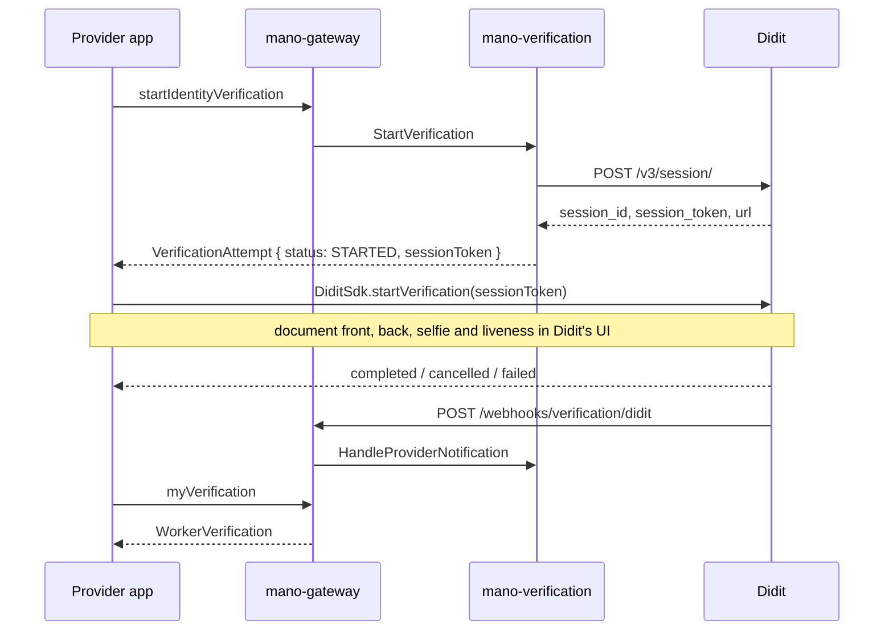

# Identity verification

A professional proves who they are before taking jobs: both sides of the
cédula and a selfie. [Didit](https://didit.me) runs the automatic checks
(document, liveness, face match) in its own native SDK; Mano's staff then
reviews and decides. The app never sees a photo: it walks the person through
Nu-style briefs, hands off **once** to Didit, and reads the result back from
the gateway.

## The port

`IdentityVerificationPort` (`mano_domain/verification/`) names no vendor:

| Method | Does |
|---|---|
| `status()` | Where the check stands |
| `verify()` | Runs the checker's own capture flow, then reports where things stand |

`IdentityCheckStatus`:

| State | Meaning | Screen |
|---|---|---|
| `IdentityCheckNotStarted` | Nothing sent, or a Didit session opened and closed unfinished | the intro |
| `IdentityCheckPending` | Didit is processing, or the staff is reviewing | "Estamos revisando tus documentos" |
| `IdentityCheckApproved` | The staff approved | the verified badge |
| `IdentityCheckRejected(reason, canRetry)` | Refused; `reason` is shown | Intentar de nuevo only when `canRetry` |

This is separate from `VerificationStatus` in `provider_onboarding.dart`,
which tracks staff review of the whole profile.

## Adapters

| Adapter | Where | Used when |
|---|---|---|
| `GatewayIdentityVerification` | `mano_data/verification/` | the build has an auth domain (`SUPERTOKENS_API_DOMAIN`) |
| `MockIdentityVerification` | `mano_data/verification/` | no auth domain; tests and Widgetbook |

`identityVerificationProvider` (`mano_session`) picks between them.

`GatewayIdentityVerification` takes a `DiditLauncher`, a one-method interface
(`start(sessionToken) → finished | cancelled | failed`) that keeps the SDK out
of `mano_data`, so the adapter is unit-tested with a fake. The real one,
`DiditSdkLauncher` (`apps/provider/lib/features/identity/didit_sdk_launcher.dart`),
wraps `didit_sdk_core` and is the provider app's override of
`diditLauncherProvider` in `main.dart`. The requester app never links Didit.

### The sequence



`startIdentityVerification` is idempotent: while an attempt is open it returns
the same session, so a person who closed Didit resumes where they left off.

### The state map

`myVerification` onto `IdentityCheckStatus` (`worker_verification_json.dart`):

| `status` | `latestAttempt.status` | App |
|---|---|---|
| `VERIFIED` | any | Approved |
| `REJECTED` | any | Rejected, `canRetry: false` (the staff's refusal is final) |
| `PENDING_REVIEW` | any | Pending |
| `IN_PROGRESS` | `PROCESSING` | Pending |
| `IN_PROGRESS` | `CREATED`, `STARTED` | NotStarted (resumable) |
| `UNVERIFIED` | `DECLINED`, `RESUBMISSION_REQUIRED` | Rejected, `canRetry: attemptsRemaining > 0` |
| `UNVERIFIED` | none, `EXPIRED`, `FAILED` | NotStarted |

The reason shown comes from `decisionReason`, else the first
`declineReasons` entry, as generic Spanish copy; the staff's note never
reaches the app.

`verify()` adds three rules:

- Didit **finished** but the webhook has not landed yet (still `STARTED`):
  Pending, not NotStarted.
- Didit **cancelled**: whatever `myVerification` says, usually NotStarted;
  the flow stays on the selfie brief.
- Didit **failed**: `DataUnavailable`.

A refused start (`FailedPrecondition` already verified, `PermissionDenied`
rejected, `ResourceExhausted` no attempts left) is not an error: `verify()`
answers with `status()`, which says which.

## The flow

The briefs follow Nu's identity check (Mobbin, "Nu iOS Screens 0–8"), in
Mano's flame and Poppins. Didit's SDK does the capturing, so they only
prepare the person:

| Nu screen | Step (`IdentityFlowStep`) | Mano screen |
|---|---|---|
| — | `loading` | `ManoLoader` while `status()` answers |
| 0, tips | `intro` | "Vamos a tomar fotos de tu cédula para **confirmar tu identidad**", tips, Continuar |
| 1, man photographing his ID | `frontBrief` | `ManoIllustratedStep`: `cedula.jpg`, "Toma la **foto del frente** de tu cédula", Continuar |
| 5, close-up of the back | `backBrief` | `cedula_back.jpg` (Nu's `verification3.png`), "**Voltea tu identificación** para tomar una foto de la parte de atrás", Continuar |
| 7, man taking a selfie | `selfieBrief` | `selfie.jpg`, "¿Tomamos tu selfie?", **Empezar** opens Didit |
| — | `pending` | "Estamos revisando tus documentos" (up to 3 business days) |
| — | `approved` | "Tu identidad está verificada" with the badge |
| — | `rejected` | The `reason`; Intentar de nuevo (back to the front brief) or, when final, Continuar |

Every brief is `BriefStep` over `ManoIllustratedStep`; copy and pictures are
`briefCopy` in `identity_copy.dart`. The pictures are provider-app assets
(`apps/provider/assets/identity/`, 1080 px tall JPEGs); `mano_ui` ships none.
While Didit is open the Empezar button spins; a failure shows as a notice on
the brief. `identityVerifiedProvider` is true once approved.

## Native setup

`didit_sdk_core` (automatic capture, no NFC) is a provider-app dependency:

- Android: minSdk 23 (Flutter's default is 24). The SDK merges `CAMERA` and
  `INTERNET`; the manifest strips its location permissions
  (`tools:node="remove"`), since the workflow has no Location step.
- iOS: deployment target 15.0 (the core variant needs 13.0).
  `NSCameraUsageDescription` and `NSMicrophoneUsageDescription` are set; a
  missing key makes iOS kill the app when Didit asks.

## Running it locally

mano-verification needs Didit's sandbox keys (`DIDIT_API_KEY`,
`DIDIT_WORKFLOW_ID`, `DIDIT_WEBHOOK_SECRET`) from Bitwarden Secrets Manager,
only through `bws run`. A memory run is enough for the app:

```bash
# mano-verification, in memory, on 50058 (50055 is chat's on one host)
cd ../mano-verification
source ~/.config/bws/env
bws run --project-id 48626d50-a88e-4f49-88e1-b4ee0127c8f8 -- \
  'VERIFICATION_PROVIDER=didit DOCUMENT_PEPPER=$(openssl rand -hex 32) \
   BIND_ADDR=127.0.0.1:50058 METRICS_ADDR=127.0.0.1:9098 \
   RECONCILE_AFTER=2m RECONCILE_INTERVAL=1m cargo run'

# mano-gateway, pointed at it (plus the rest of ../mano-gateway/docs/local-stack.md)
cd ../mano-gateway && VERIFICATION_URL=http://127.0.0.1:50058 cargo run

# the provider app, signing in for real so the gateway adapter is used
adb reverse tcp:8082 tcp:8082 && adb reverse tcp:3001 tcp:3001
cd apps/provider && flutter run -d RFGL20WAR9E \
  --dart-define=SUPERTOKENS_API_DOMAIN=http://localhost:3001
```

Didit cannot reach a laptop's webhook, and it does not have to: the
**reconciler** in mano-verification fetches every attempt still open after
`RECONCILE_AFTER` from Didit's API and applies a final decision, so a lost
(or never-sent) webhook only delays the result. Until then the app shows
Pending. To get webhooks too, expose the gateway (e.g. a tunnel) and set the
workflow's callback to `https://<tunnel>/webhooks/verification/didit`.

Without `SUPERTOKENS_API_DOMAIN` the app uses the mock: Empezar answers
Pending, or Approved with `--dart-define=MANO_APPROVE_IDENTITY=true`
(`ManoConfig.approveIdentityChecks`), to walk the gates.

## The gate

The check can be put off ("Ahora no"), but until it is **approved** a pro can
only browse. A pending check does not count. Every action that commits a pro
to a client goes through one guard, `requireVerified` (`apps/provider/lib/features/identity/verification_gate.dart`):

- accepting or rejecting a request (Inicio)
- sending a quote (Cotizar gratis)
- buying a lead (Comprar contacto, from the project or from Mis cotizaciones)
- publishing, saving or reactivating an offer
- chatting with a client: sending a message or a photo, and opening a job's
  chat (Escribir). Reading the inbox and existing threads stays open. A
  message held by the gate stays in the composer: `ManoMessageComposer`
  clears only when `onSend` answers true.

A guest is asked to sign in first (`requireAccount`). A signed-in pro who is
not verified gets "Verifica tu identidad para continuar" with **Verificar
ahora** (opens `/profile/identity`) and **Ahora no**. The decision itself is
`IdentityFlowNotifier.verified()` in `mano_session`, which loads the status
first if nothing has asked yet.

### Where it shows

- Provider onboarding: right after the account is created (`identity` step,
  between password and name). "Ahora no" puts it off; system back walks the
  briefs. If the check was put off, the closing screen says "Falta verificar
  tu identidad" with **Verificar mi identidad** (opens `/profile/identity`)
  instead of "Tu cuenta está en revisión".
- Perfil: an "Verifica tu identidad" row (or "Verificación en revisión",
  "Identidad verificada") opens `/profile/identity`. The header's verified
  badge shows when the profile says so or the check is approved.

## Didit branding (white label)

Didit draws its own capture screens; we restyle them as Mano. Two settings,
both per Didit application (sandbox and live are separate, so repeat for live):

1. **Style**, `PATCH /v3/customization/` (JSON): `ManoColors` (flame primary
   and buttons, ink text, sand panels), Poppins 400, `border_radius_panel: 14`,
   `border_radius_buttons: 28` (pill), `app_public_name: "Mano"`,
   `skip_welcome_screen`, `hide_progress_bar` and `disable_login_with_didit`
   all `true`. Logos go up as multipart `image_square` (512×512 monogram) and
   `image_rectangular` (exactly 2:1, the wordmark), rendered flame from
   `tools/brand/*.svg`. Poppins takes a numeric `font_weight`.
2. **Workflow**, `PATCH /v3/workflows/{DIDIT_WORKFLOW_ID}/` with
   `{"is_white_label_enabled": true, "status": "published"}`. Without
   `published` the change lands in a draft and sessions keep Didit's look.

Both calls take `x-api-key: $DIDIT_API_KEY` through `bws run`. Didit follows the
phone's light or dark mode. The sandbox banner and its "choose a test result"
sheet only exist in sandbox.

A fully native capture (our own camera screens over Didit's standalone ID
Verification, Passive Liveness and Face Match APIs) is planned for after launch.
