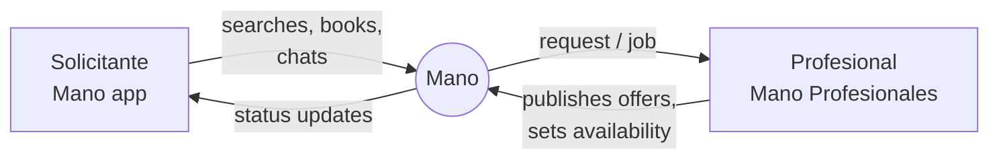

# How Mano works

Mano is a marketplace for home services in Colombia: cleaning, plumbing,
electrical work, painting and gardening.

## The vocabulary

| Term | Meaning |
|---|---|
| **Service** (`JobService`) | A kind of work in the catalogue, e.g. "Limpieza profunda del hogar". |
| **Offer** (`ServiceOffer`) | One professional's price for a service: **fixed** or **hourly**, plus an optional zone. |
| **Availability** | A professional's weekly time windows, minus blocked dates. |
| **Request** (`ServiceRequest`) | A requester asking for work with a message and a proposed time; the professional accepts or rejects it. |
| **Job** (`Job`) | Agreed work with a time slot. Created by booking a free slot directly, or when a request is accepted. |
| **Conversation** | Chat between the two sides. |

## Two business models

- **Small and medium tasks.** Booked and paid inside the app, with Mano's fee
  deducted automatically. This is what the apps build today.
- **Large projects.** A paid-lead model: professionals quote and Mano steps out
  before payment. Not built yet.

Read on for each side's journey: [Requester](requester.md) ·
[Provider](provider.md) · [Statuses](lifecycle.md).
