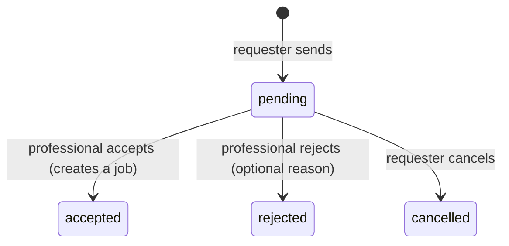
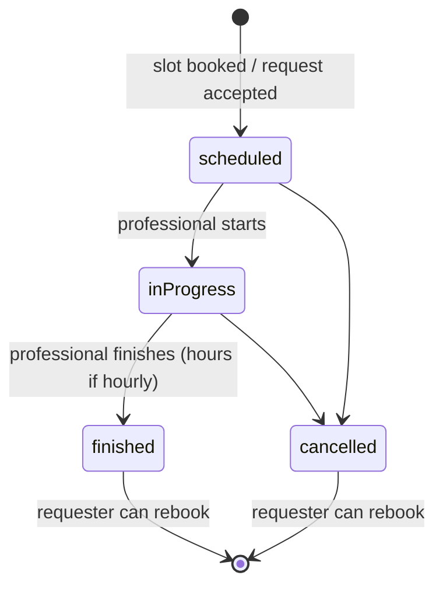
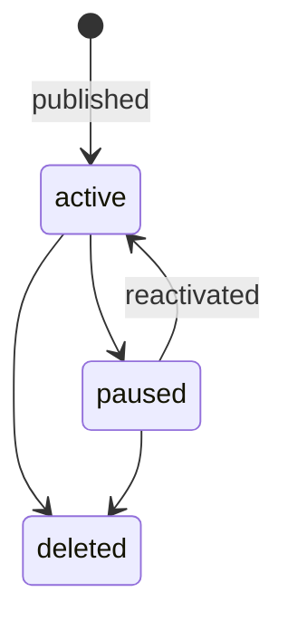

# Statuses

Every request, job and offer moves through a small set of states. The rules live
on the entities in `mano_domain`; screens only ask them (`job.canStart` and so
on).

## Request

## Job

| Rule | Where |
|---|---|
| Only a scheduled job can start | `Job.canStart` |
| Only a job in progress can finish | `Job.canFinish` |
| Scheduled or in-progress jobs can be cancelled | `Job.canCancel` |
| Finished or cancelled jobs can be rebooked | `Job.canRebook` |
| Hourly jobs need hours worked to finish | `Job.requiresHoursOnFinish` |

## Offer

Deleted offers are kept (soft delete) but disappear from every list.

## How statuses look

| Status | Label | Tone |
|---|---|---|
| Request pending / job scheduled | Pendiente / Programado | `info` |
| Job in progress | En curso | `warning` |
| Job finished / request accepted / offer active | Finalizado / Aceptada / Activa | `success` |
| Cancelled, rejected or paused | Cancelado / Rechazada / Pausada | `neutral` |
