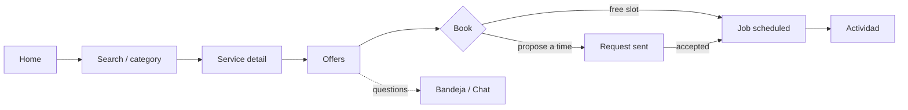

# Requester journey (Mano app)

## Screens

| Tab | Screens | What happens |
|---|---|---|
| **Inicio** | Home → Search → Service detail → Offers → Booking | Find a service, compare offers (price, fixed or hourly, zone), pick a day and slot, or propose a time with a message. |
| **Actividad** | Activity → Job detail | Requests and jobs by status; cancel or rebook. |
| **+** | Create sheet | Start something new (post a job; coming soon). |
| **Bandeja** | Inbox → Chat | Talk to professionals in real time. |
| **Perfil** | Profile | Account and settings. |

## Guests

Anyone can browse, search and see offers without an account. Confirming a booking
asks the person to sign in.

## Onboarding

On first launch: a three-slide tour, then sign up (email, phone or Google) or
"Omitir" to browse. Registration asks for name and address. Requesters are not
verified, unlike professionals.
